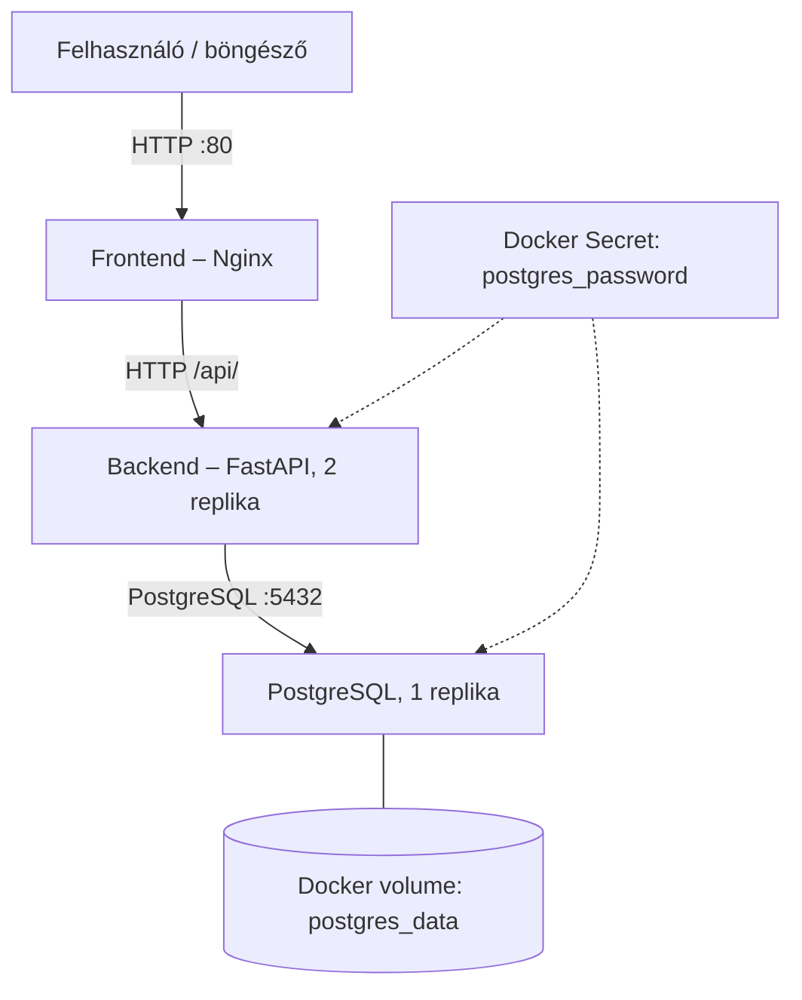

# Mini Task Manager – Docker Swarm projekt

Egyszerű, háromrétegű webes feladatkezelő alkalmazás, amely Docker Swarm környezetben, Microsoft Azure Linux virtuális gépen működik.

A projekt a **Felhőszámítás / Cloud Computing – Docker Swarm alkalmazás telepítése** gyakorlati feladat részeként készült.

## 1. Az alkalmazás célja

A Mini Task Manager egy webes CRUD-alkalmazás, amely feladatok létrehozását, listázását, módosítását, elkészültnek jelölését és törlését teszi lehetővé.

A feladatok PostgreSQL-adatbázisban tárolódnak, így a konténerek újralétrehozása után is megmaradnak.

## 2. Felhasznált technológiák

| Réteg | Technológia | Feladat |
|---|---|---|
| Frontend | HTML, CSS, JavaScript, Nginx 1.28 | Felhasználói felület és reverse proxy |
| Backend | Python 3.12, FastAPI, Uvicorn | REST API és üzleti logika |
| Adatbázis | PostgreSQL 17.6 | Tartós adattárolás |
| Konténerizáció | Docker Engine | Image-ek és konténerek |
| Orkesztráció | Docker Swarm | Szolgáltatások és replikák kezelése |
| Registry | Docker Hub | Verziózott alkalmazás-image-ek |
| Infrastruktúra | Microsoft Azure, Ubuntu Server 24.04 LTS | Távoli Linux-környezet |

## 3. Architektúra



Mindhárom szolgáltatás egy közös Docker Swarm overlay hálózaton kommunikál.

A frontend az egyetlen publikált alkalmazásszolgáltatás, a backend és az adatbázis csak a belső hálózaton érhető el.

A Docker Swarm egyetlen manager node-on működik, amely a szolgáltatások futtatását is végzi.

## 4. Infrastrukturális környezet

| Paraméter | Érték |
|---|---|
| Felhőszolgáltató | Microsoft Azure |
| Előfizetés | Azure for Students |
| Régió | Sweden Central |
| Virtuális gép | Standard B2ls v2 |
| CPU | 2 vCPU |
| Memória | 4 GiB |
| Operációs rendszer | Ubuntu Server 24.04 LTS |
| Swarm-node-ok száma | 1 |
| Node szerepe | Manager / Leader |

Az alkalmazás bemutatása közvetlenül a virtuális gép nyilvános HTTP-címén történik.

**Nyilvános alkalmazás:** http://135.225.135.16

A megadott IP-cím és az alkalmazás csak akkor érhető el, amikor az Azure virtuális gép fut.

## 5. Repository és Docker-image-ek

**GitHub repository:**

https://github.com/VPe187/docker-swarm-taskmanager

**Docker Hub image-ek:**

- `vpe187/taskmanager-frontend:2.0`
- `vpe187/taskmanager-backend:2.0`
- `postgres:17.6`

Az alkalmazás saját Dockerfile-ok alapján készül, a Swarm telepítéséhez pedig a `stack.yml` fájlt használjuk.

## 6. Projektstruktúra

```text
docker-swarm-project/
├── frontend/
│   ├── Dockerfile
│   ├── index.html
│   └── default.conf
├── backend/
│   ├── Dockerfile
│   ├── main.py
│   └── requirements.txt
├── stack.yml
├── .gitignore
└── README.md
```

A helyi adatbázisjelszó és az SQL-biztonsági mentés nem része a repositorynak.

## 7. Előfeltételek

- Ubuntu Linux Docker Engine telepítéssel
- Működő Docker Swarm manager node
- Docker CLI
- Internetkapcsolat a Docker-image-ek letöltéséhez
- Elérhető TCP 80-as port a webalkalmazáshoz
- Docker Hub-hozzáférés, ha a használt image-ek privátak

A Swarm inicializálása:

```bash
sudo docker swarm init
```

A node ellenőrzése:

```bash
sudo docker node ls
```

## 8. Docker-image-ek építése

Frontend:

```bash
sudo docker build -t vpe187/taskmanager-frontend:2.0 ./frontend
```

Backend:

```bash
sudo docker build -t vpe187/taskmanager-backend:2.0 ./backend
```

Az image-ek feltöltése:

```bash
sudo docker push vpe187/taskmanager-frontend:2.0
sudo docker push vpe187/taskmanager-backend:2.0
```

A Docker Stack a Dockerfile-okat nem építi meg automatikusan.

## 9. Docker Secret létrehozása

A PostgreSQL-jelszót Docker Secret segítségével adjuk át a szolgáltatásoknak.

```bash
openssl rand -base64 32 > db_password.txt
```

```bash
sudo docker secret create postgres_password db_password.txt
```

A secret ellenőrzése:

```bash
sudo docker secret ls
```

A `db_password.txt` bizalmas fájl, ezért a `.gitignore` kizárja a verziókezelésből.

A jelszó megőrzéséről külön gondoskodni kell. A fájl helyi példánya biztonságosan törölhető, miután a secret létrejött és a szükséges hozzáférési adatok megőrzése megoldott.

## 10. Docker Swarm Stack telepítése

A konfiguráció ellenőrzése:

```bash
sudo docker stack config -c stack.yml
```

Telepítés:

```bash
sudo docker stack deploy -c stack.yml taskmanager
```

Privát registry esetén szükség lehet a `--with-registry-auth` kapcsolóra.

A szolgáltatások ellenőrzése:

```bash
sudo docker stack services taskmanager
```

A taskok állapota:

```bash
sudo docker stack ps taskmanager
```

Elvárt replikaszámok:

| Szolgáltatás | Replikák |
|---|---|
| Frontend | 1/1 |
| Backend | 2/2 |
| PostgreSQL | 1/1 |

## 11. REST API

| Metódus | Végpont | Funkció |
|---|---|---|
| GET | `/api/health` | Backend állapotának ellenőrzése |
| GET | `/api/tasks` | Feladatok lekérdezése |
| POST | `/api/tasks` | Új feladat létrehozása |
| PATCH | `/api/tasks/{id}` | Feladat módosítása |
| DELETE | `/api/tasks/{id}` | Feladat törlése |

Az API a PostgreSQL-adatbázist használja, amely a Docker Swarm belső hálózatán érhető el.

A backend szükség esetén automatikusan létrehozza a `tasks` táblát.

## 12. Funkcionális tesztek

A böngészős felületen az alábbi műveletek sikeresen működtek:

- Új feladat létrehozása.
- Feladatok megjelenítése.
- Feladat címének módosítása.
- Feladat elkészültnek jelölése.
- Feladat törlése.

Az API lekérdezésének tesztje:

```bash
curl -i http://localhost/api/tasks
```

A teszt eredménye: `HTTP 200 OK`.

## 13. Skálázási teszt

A FastAPI backend eredetileg két replikával működött.

Skálázás három replikára:

```bash
sudo docker service scale taskmanager_backend=3
```

Az eredmény:

```text
overall progress: 3 out of 3 tasks
verify: Service taskmanager_backend converged
```

A teszt után a backend visszaállítása két replikára:

```bash
sudo docker service scale taskmanager_backend=2
```

**Eredmény:** a horizontális skálázás sikeres.

## 14. Automatikus helyreállítás

A teszt során az egyik FastAPI-konténert manuálisan leállítottuk a `docker stop` paranccsal.

A Swarm a kiesett konténer helyett automatikusan új taskot hozott létre.

A folyamatot a következő paranccsal ellenőriztük:

```bash
sudo docker service ps taskmanager_backend
```

**Eredmény:** a konténerszintű automatikus helyreállítás sikeres.

## 15. PostgreSQL perzisztenciateszt

A PostgreSQL adatainak tárolására a `taskmanager_postgres_data` Docker volume szolgál.

A teszt menete:

1. Korábban rögzített feladatok lekérdezése.
2. A PostgreSQL-konténer leállítása.
3. A Swarm új PostgreSQL-taskot indított.
4. A feladatok ismételt lekérdezése.

A konténer újralétrehozása után a korábbi feladatok megmaradtak.

**Eredmény:** a tartós adattárolás igazolt azonos node-on.

## 16. Healthcheckek

A három szolgáltatás healthcheckkel rendelkezik:

- Frontend: Nginx-konfiguráció ellenőrzése.
- Backend: HTTP `/api/health` végpont.
- PostgreSQL: `pg_isready`.

A teszt során mind a négy konténer `healthy` állapotú volt.

## 17. Biztonság

- A PostgreSQL és a FastAPI portja nem publikált az internet felé.
- A PostgreSQL-jelszó Docker Secretben található.
- A jelszófájl és a biztonsági mentés ki van zárva a Git-repositoryból.
- Az Azure-szerver SSH-kulcsos hitelesítést használ.
- A bemutató alkalmazás kizárólag tesztadatokat kezel.

A nyilvános HTTP-kapcsolat titkosítatlan; a rendszer nem tartalmaz felhasználói hitelesítést. Emiatt éles vagy személyes adatok kezelésére jelenlegi formájában nem alkalmas.

## 18. Ismert korlátozások

- A Swarm egyetlen node-on fut, ezért nem biztosít node-szintű hibatűrést.
- A PostgreSQL egyetlen példányban fut.
- A Docker volume helyi tárolót használ, nem megosztott klasztertárhelyet.
- Az alkalmazás HTTP-t használ HTTPS helyett.
- Nincs felhasználói hitelesítés és jogosultságkezelés.
- A felhőkörnyezet az Azure for Students kreditjét fogyasztja, ezért az üzemidő korlátozott lehet.

## 19. A Stack eltávolítása

A szolgáltatások eltávolítása:

```bash
sudo docker stack rm taskmanager
```

Ez eltávolítja a stack szolgáltatásait és hálózatait, de a külső Docker Secret és a tartós adatokkal rendelkező volume kezeléséről külön kell gondoskodni.

**Figyelem:** a volume törlése adatvesztést okoz.

## 20. Összegzés

A projektben működő, három különböző Swarm-szolgáltatásból álló webalkalmazás készült, amely Docker Hubon tárolt saját image-eket, overlay hálózatot, titokkezelést és tartós adatbázist használ.

A skálázási, konténerszintű helyreállítási, perzisztencia- és webes elérhetőségi tesztek sikeresek voltak.

A megoldás bemutatja a Docker Swarm legfontosabb szolgáltatásorkesztrációs képességeit egyetlen Azure Linux virtuális gépen.
